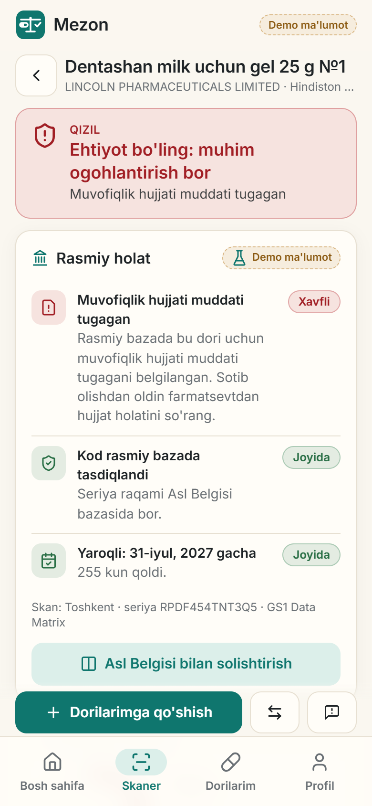
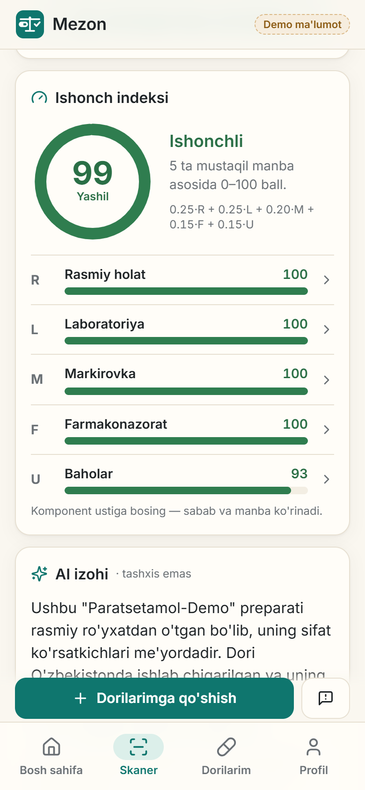
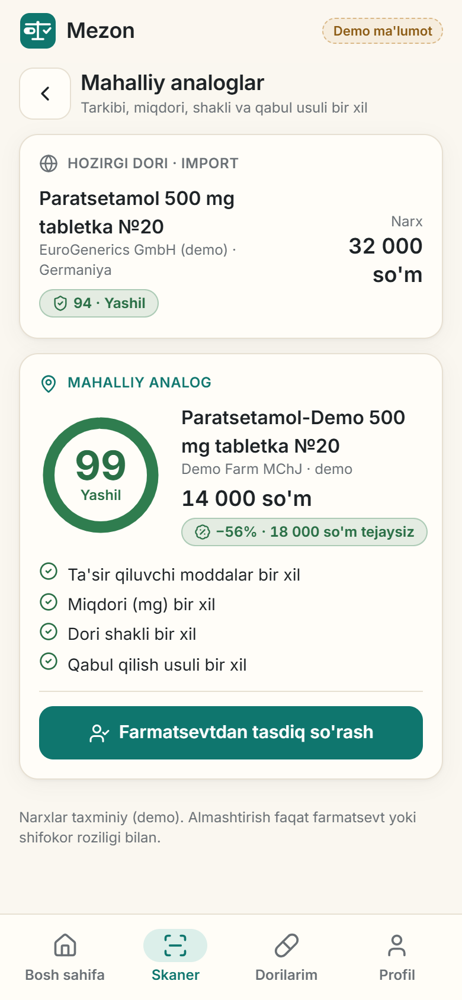
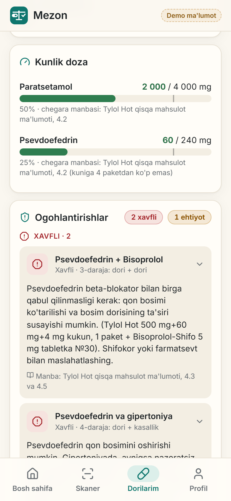

# Mezon — mahalliy dorilarga ishonch va xavfsiz qabul platformasi

Bemor dori qadog'idagi Data Matrix kodini skanerlaydi va bitta ekranda ko'radi: dori haqiqiymi, sifat dalili bormi,
mos mahalliy analog bormi va u boshqa dorilari hamda surunkali kasalliklari bilan xavfsizmi.

**Toshkent AI Hackathon (Milliy AI Xakaton) 2026 · muammo №17 · Sog'liqni saqlash va farmatsevtika**

| | |
|---|---|
| 🌐 Jonli demo | <https://mezon.zehnprotect.uz> — bemor ilovasi |
| 🧑‍⚕️ Xodimlar konsoli | <https://mezon.zehnprotect.uz/staff.html> — farmatsevt va ishlab chiqaruvchi |
| 📊 Taqdimot | [docs/Mezon_taqdimot.pdf](docs/Mezon_taqdimot.pdf) · [docs/Mezon_taqdimot.pptx](docs/Mezon_taqdimot.pptx) |
| 🎬 Demo ssenariysi | [DEMO.md](DEMO.md) |
| 📘 API hujjatlari | <https://mezon.zehnprotect.uz/docs> (Swagger UI) |

> Mezon tashxis qo'ymaydi, dori tayinlamaydi va dozani belgilamaydi. Ogohlantirishlarni faqat farmatsevt
> tasdiqlagan qoidalar chiqaradi — AI hech qachon ogohlantirish yaratmaydi yoki o'chirmaydi.

---

## Muammo

O'zbekistonga 2025-yilda **$1,78 mlrd** lik dori va tibbiy buyum import qilingan (+6,4 %). Shu yili
**57 000+ nomdagi** kontrafakt dori aniqlangan (spot.uz, 21.01.2026). Qadoqda Asl Belgisi kodi bor, lekin uning
javobi («Muvofiqlik hujjatining tugaganligi belgisi: Ha») oddiy bemorga tushunarsiz. Sifatli mahalliy dori ham,
qalbaki nusxa ham bemorga bir xil ko'rinadi, shuning uchun u arzonroq mahalliy analog o'rniga importni tanlaydi.
Bitta retseptda 10–15 dori bo'lishi mumkin (Gazeta.uz, 29.10.2026). Bir xil modda ikki xil qutida bo'lsa
(masalan, paratsetamol va Tylol Hot), kunlik xavfsiz doza osongina oshib ketadi.

## Yechim

1. **Ishonch indeksi (0–100).** Ro'yxat holati, partiya tahlil sertifikati (CoA), GMP, markirovka, farmakonazorat va
   baholar bitta ballga yig'iladi. Har komponent o'z manbasi va sanasi bilan ko'rsatiladi; pul yoki reklama ballni
   o'zgartirmaydi.
2. **Mahalliy analog + farmatsevt tasdig'i.** Import dori uchun tarkibi, miqdori, shakli va qabul usuli bir xil
   mahalliy dori, narx farqi va uning Ishonch indeksi ko'rsatiladi. Almashtirishni dastur emas, farmatsevt tasdiqlaydi.
3. **4 darajali xavfsizlik tekshiruvi.** Dori «Dorilarim»ga qo'shilishidan oldin quyidagilar tekshiriladi: takroriy
   modda, kunlik jami doza, dori + dori, dori + surunkali kasallik. Har ogohlantirish manba bo'limi bilan keladi.

## Skrinshotlar

| Rasmiy holat tushunarli tilda | Ishonch indeksi | Mahalliy analog | Xavfli kombinatsiya |
|:---:|:---:|:---:|:---:|
|  |  |  |  |

Boshqa ekranlar (xodimlar konsoli va qorong'i mavzu): [`screenshots/`](screenshots/).

## AI qayerda va qanday ishlatiladi

`app/llm.py` da 5 ta vazifa bor. Har biri qat'iy JSON sxema bilan ishlaydi, javobi validatsiyadan o'tadi va
`llm_cache` jadvalida keshlanadi.

| Vazifa | Nima qiladi |
|---|---|
| `leaflet_to_rules` | Dori yo'riqnomasidan (demo: Tylol Hot, turkcha KÜB 4.2–4.6) xavfsizlik qoidalari takliflarini chiqaradi |
| `extract_coa` | Tahlil sertifikati PDF'idan ko'rsatkichlar va partiya raqamini oladi; me'yorga solishtirish Python'da |
| `normalize_inn` | Qadoqdagi xom nomni INN'ga keltiradi («Metrodonidazol» → metronidazol, «hlorgeksedin» → xlorgeksidin) |
| `explain_uz` | Skan natijasini 2–3 gapli o'zbekcha izohga aylantiradi |
| `classify_report` | Bemorning nojo'ya ta'sir xabarini toifa va jiddiylik bo'yicha tasniflaydi |

**Himoya choralari**

- **AI ogohlantirish yaratmaydi va o'chirmaydi.** Ogohlantirishlarni deterministik xavfsizlik dvigateli
  (`app/safety.py`) chiqaradi, u faqat `approved=true` qoidalar bilan ishlaydi.
- **Qoidalarni farmatsevt tasdiqlaydi.** AI taklif qilgan har qoida `approved=false` bo'lib saqlanadi. U faqat shu
  dorining o'z moddasiga tegishli bo'lsa va yo'riqnomadagi bo'lim raqamini ko'rsatsa qabul qilinadi.
- **Izoh guardrail'i.** Javobda dozalash ko'rsatmasi bo'lsa yoki muhim ogohlantirish (masalan, muvofiqlik hujjati)
  tilga olinmasa, javob rad etiladi va tayyor matnga o'tiladi.
- **PII maskalanadi.** Har so'rovdan oldin `pii.mask()` FISh, JShShIR (14 raqam) va +998 telefon raqamlarini
  `[FISh]`, `[JShShIR]`, `[TELEFON]` bilan almashtiradi.
- **Ishonchli zanjir:** kesh → asosiy model (20 s timeout) → zaxira model bir marta → tayyor natija
  (`data/precomputed_llm.json`). Timeout, 429, noto'g'ri JSON yoki validatsiyadan o'tmagan javob keyingi bosqichga
  o'tkazadi. Ketma-ket xatodan keyin 30 s davomida jonli chaqiruvlar o'tkazib yuboriladi. Natija manbasi UI'da
  ko'rinadi: *jonli · kesh · zaxira · tayyor natija*.

## Texnologiyalar va arxitektura

| Qatlam | Texnologiya |
|---|---|
| Backend | Python 3.11+, FastAPI, SQLModel + SQLite, Pydantic v2 |
| AI | Google Gemini (`google-genai`): asosiy `gemini-3.5-flash-lite`, zaxira `gemini-3.1-flash-lite`. Anthropic Claude — ixtiyoriy provayder (`LLM_PROVIDER=anthropic`) |
| Frontend | Statik HTML + vanilla JS (ES modullar, build yo'q), Tailwind, Lucide ikonlari, Chart.js, Inter shrifti — barchasi `web/vendor/` da, internetsiz ishlaydi |
| Skaner | Kamera: brauzerning `BarcodeDetector` i, bo'lmasa `@zxing/library` ramka ichidagi kesimda. Rasm: brauzer → ZXing → server `POST /api/decode-image` (zxing-cpp + Pillow) |
| Hujjatlar | `pdfplumber` (CoA va yo'riqnoma matni), `reportlab` (mock CoA PDF'lar), `bwip-js` (demo Data Matrix kodlari) |

```
Telefon / brauzer ──► FastAPI (app/main.py)
  web/index.html       ├─ /api/scan ──► gs1.py ──► Asl Belgisi mock ──► trust.py ──► analogs.py
  web/staff.html       ├─ /api/safety ─► safety.py (deterministik, tasdiqlangan qoidalar)
                       ├─ /api/admin/llm/* ─► llm.py ──► pii.mask ──► kesh → Gemini → zaxira → tayyor natija
                       └─ SQLite (mezon.db): mahsulotlar, partiyalar, kodlar, qoidalar, skanlar, audit log
```

## Ishga tushirish

Python **3.11+** kerak (Windows, macOS, Linux). API kalit **shart emas**: kalitsiz ham ilova to'liq ishlaydi, barcha
AI natijalari keshdan yoki `data/precomputed_llm.json` dan olinadi.

```bash
git clone https://github.com/SnowCyberSecurity21/tashkent_ai_hackaton.git
cd tashkent_ai_hackaton
python -m venv .venv
# Windows:      .venv\Scripts\activate
# macOS/Linux:  source .venv/bin/activate
pip install -r requirements.txt

# ixtiyoriy — jonli AI uchun: .env.example ni .env ga nusxalab, GEMINI_API_KEY ni yozing
#   Windows: copy .env.example .env      macOS/Linux: cp .env.example .env

python -m uvicorn app.main:app --port 8000     # yoki: run.bat (Windows) / ./run.sh (macOS/Linux)
```

Baza (`mezon.db`) birinchi startda avtomatik yaratiladi va demo ma'lumot bilan to'ldiriladi. Qaytadan yaratish uchun:
`python scripts/seed.py`.

- Bemor ilovasi: <http://localhost:8000>
- Xodimlar konsoli: <http://localhost:8000/staff.html>
- API hujjatlari: <http://localhost:8000/docs>
- Holat: <http://localhost:8000/api/health> → `"ok": true`

`.env` sozlamalari (`.env.example` da izohlar bilan):

| O'zgaruvchi | Ma'nosi |
|---|---|
| `LLM_PROVIDER` | `gemini` (standart) yoki `anthropic` |
| `GEMINI_API_KEY`, `GEMINI_MODEL`, `GEMINI_FALLBACK_MODEL` | Gemini kaliti, asosiy va zaxira model |
| `LLM_TIMEOUT_S` | har bir AI chaqiruvi uchun qattiq timeout (standart 20 s) |
| `MEZON_LLM_OFFLINE=1` | jonli chaqiruvlarni butunlay o'chiradi (faqat kesh va tayyor natija) |
| `DEMO_MODE=1` | rolni `X-Demo-Role` sarlavhasi bilan tanlash (patient, pharmacist, maker, admin) |

**Telefonda kamera bilan:** telefon brauzerlari kamerani faqat HTTPS orqali ochadi. Jonli demo HTTPS'da ishlaydi.
Lokal nusxa uchun `cloudflared tunnel --url http://localhost:8000` yoki `ngrok http 8000` (Windows'da `tunnel.bat`).
Profil → «Telefonda ochish (QR havola)» joriy manzilni QR kod qilib ko'rsatadi.

## Testlar

```bash
pip install -r requirements-dev.txt
python -m pytest -q                 # 42 passed
python scripts/smoke_test.py        # server ishlab turganda: demo oqimining 34 qadami, PASS/FAIL
```

Unit testlar quyidagilarni qamraydi: GS1 parser (jumladan haqiqiy qadoqdagi kodning turli dekoder variantlari),
Ishonch indeksi, xavfsizlik dvigateli, LLM fallback zanjiri va PII maskalash, server tomonidagi rasm dekoderi, demo reset.

## Qanday ishlaydi

**GS1 parser** (`app/gs1.py`) quyidagi kirishlarni qabul qiladi:

- GS (`\x1d`) ajratgichli xom satr, `]d2` prefiks bilan yoki prefikssiz;
- qavsli `(01)…(21)…` ko'rinish;
- GS'i tushib qolgan satr — memoizatsiyali backtracking bilan ajratiladi;
- EAN-13 (GTIN = `"0"` + EAN, «aniq muddat uchun Data Matrix'ni skanerlang»).

AI'lar: 01, 17, 11 (fiks), 21, 10, 91/92/93 (o'zgaruvchan; kripto qism saqlanadi, tahlil qilinmaydi). `17` da
DD=00 — oyning oxirgi kuni. Haqiqiy Asl Belgisi qadog'i formati:
`01<GTIN> 21<seriya> GS 17<YYMMDD> 10<partiya> GS 91<kalit> GS 92<kripto>`.

**Ishonch indeksi** (`app/trust.py`) = 0.25·R + 0.25·L + 0.20·M + 0.15·F + 0.15·U

| Komponent | Hisob |
|---|---|
| R — rasmiy holat | ro'yxatdan o'tgan 40 + muvofiqlik hujjati amal qiladi 30 + GMP 30 |
| L — laboratoriya | oxirgi partiya CoA'si bor 40 + barcha ko'rsatkichlar me'yorda 40 + bioekvivalentlik 20 (CoA yo'q → 0) |
| M — markirovka | 100; klon kod −60; qaytarib olingan partiya → 0 |
| F — farmakonazorat | 100 − tasdiqlangan jiddiy xabarlar × 10 (10 000 skanga); ma'lumot kam → 70 |
| U — baholar | farmatsevt va foydalanuvchi baholari o'rtachasi × 20; baho yo'q → 60 |

Rang: ≥80 yashil, 60–79 sariq, <60 qizil. CoA yo'q va skan <5 bo'lsa — kulrang «Ma'lumot yetarli emas».
Har komponent sababi, manbasi va sanasi bilan qaytadi. Klon kod: bitta seriya 2+ turli shaharda skanerlansa,
ogohlantirish chiqadi va M tushadi.

**Xavfsizlik dvigateli** (`app/safety.py`) — sof funksiyalardan iborat, LLM'siz va deterministik. 4 daraja:

1. **Takroriy modda.** Bitta INN ikki xil mahsulotda bo'lsa.
2. **Kunlik jami doza.** Σ(mg × dona/kun) hisoblanadi: ≥80 % — ehtiyot, >100 % — xavfli. Paratsetamol chegarasi
   4 000 mg, spirtli ichimlik bo'lsa 2 000 mg.
3. **Dori + dori.** INN yoki sinf bo'yicha, masalan NSAID + NSAID, psevdoefedrin + beta-bloker.
4. **Dori + kasallik.** Nazoratsiz gipertoniya, astma, glaukoma va boshqalar.

Sinflar `data/classes.json` da. Har xabar manba bo'limi va «Shifokor yoki farmatsevt bilan maslahatlashing» bilan
keladi.

**Rollar va audit** (`app/auth.py`, `app/audit.py`). `DEMO_MODE=1` da rol `X-Demo-Role` sarlavhasi bilan tanlanadi.
Bu bitta dependency — keyinchalik Telegram initData yoki haqiqiy login bilan almashtiriladi. Har yozish amali
`AuditLog` ga tushadi.

## Nima namunaviy (mock)

Kodda `# MOCK:` izohi, UI'da «Demo ma'lumot» belgisi bilan belgilangan:

- **Asl Belgisi integratsiyasi** (`app/integrations/asl_belgisi_mock.py`) — haqiqiy API mijozi shaklidagi mock;
- **mahsulotlar, partiyalar, seriyalar va narxlar** — taxminiy; skanlar, baholar va xabarlar ham namunaviy;
- **mahalliy ishlab chiqaruvchilar** — o'ylab topilgan nomlar (haqiqiy kompaniyalarga baho berilmaydi);
- **CoA PDF'lar** (`scripts/make_coa_pdfs.py`) — bittasida «Erish tezligi» me'yordan past.

Haqiqiy ma'lumot: Tylol Hot qisqa mahsulot ma'lumoti (`data/leaflets/tylol-hot.pdf`, turkcha) va jamoaning haqiqiy
Dentashan qutisidagi Data Matrix kodi (GTIN 08906045340359, partiya EU601).

## Biznes model

| Mijoz | Nima oladi | Narx |
|---|---|---|
| Mahalliy ishlab chiqaruvchilar (asosiy, B2B) | shaffof profil, CoA joylash, hududiy skan analitikasi, klon kod ogohlantirishi, talab signali | 3–10 mln so'm/oy |
| Dorixonalar (B2B2C) | «Ishonchli dorixona» belgisi, kassadagi skaner, mahalliy analog tavsiyasi, muddati yaqin dorilar nazorati | 200–500 ming so'm/oy |
| Bemorlar (B2C) | skan, Ishonch indeksi, analog, xavfsizlik tekshiruvi | bepul |

Ishlab chiqaruvchi dalil joylash uchun to'laydi, lekin ballni sotib ololmaydi. Batafsil hisob — [taqdimotda](docs/Mezon_taqdimot.pdf).

## Jamoa

| | Rol |
|---|---|
| **Rasulberdi Anorov** | Founder, Lead developer |
| **Boliyeva Muqaddas** | Data analitik |
| **Sharipova Dinora** | Project manager |

Aloqa: **+998 93 724 51 21**

## Papka tuzilmasi

```
app/            FastAPI ilovasi
  main.py         routerlar, static, startup (bazani avtomatik yaratadi)
  gs1.py          Data Matrix / GS1 parser
  trust.py        Ishonch indeksi
  safety.py       4 darajali xavfsizlik dvigateli
  analogs.py      mahalliy analog qidiruv
  llm.py, pii.py  AI vazifalari, fallback zanjiri, PII maskalash
  passport.py     skan natijasi (rasmiy holat, ogohlantirishlar, izoh)
  auth.py, audit.py
  integrations/   asl_belgisi_mock.py
  routers/        scan, products, safety, patient, approvals, reports, maker, admin
web/            index.html (bemor), staff.html (konsol), css/, js/ (ES modullar), vendor/ (offline kutubxonalar)
data/           products, batches, codes, rules, classes, conditions (JSON), precomputed_llm.json, coa/, leaflets/
scripts/        seed, build_data, build_precomputed, make_coa_pdfs, warm_cache, check_models, smoke_test
tests/          pytest testlari va fixtures/
docs/           taqdimot (PDF, PPTX)
screenshots/    ekran rasmlari (yorug' va qorong'i)
```

Ma'lumotlarni qayta generatsiya qilish:
`python scripts/build_data.py && python scripts/build_precomputed.py && python scripts/make_coa_pdfs.py && python scripts/seed.py`.

## Cheklovlar

- Rasmiy manbalar (Asl Belgisi, davlat reyestri, laboratoriya, farmakonazorat) hozircha mock; real integratsiya
  2026-yil 5-martdagi PF-35 farmoni asosida rejalashtirilgan.
- Bitta demo bemor (Aziza); haqiqiy autentifikatsiya yo'q — rollar `X-Demo-Role` bilan.
- Kamera skaneri HTTPS talab qiladi. Tailwind Play skripti vendored: CSS brauzerda hosil bo'ladi.
- Ishonch indeksi vaznlari demo uchun; real foydalanishda regulyator va klinik ekspertlar bilan kelishiladi.

## Keyingi qadamlar

- **Telegram bot va Mini App** (aiogram 3): /start → Mini App tugmasi, farmatsevtga tasdiq so'rovi xabari,
  Telegram `initData` HMAC autentifikatsiyasi. Frontend nisbiy yo'llar bilan yozilgan — Mini App sifatida o'zgarishsiz ochiladi.
- Asl Belgisi va davlat reyestri bilan real integratsiya.
- Toshkentda pilot: 3 ishlab chiqaruvchi, 10 dorixona, 1 000 foydalanuvchi.
- Flutter mobil ilova, oilaviy dori nazorati.
- Davlat uchun importni almashtirish xaritasi.

---

## English summary

Mezon is a trust and safe-use platform for medicines in Uzbekistan, built for the Tashkent AI Hackathon 2026
(problem #17). A patient scans the GS1 Data Matrix code on a medicine pack and gets the official status in plain
Uzbek, plus a 0–100 Trust Index. Every component of the index cites its source: registration, batch CoA, marking,
pharmacovigilance and ratings. For imported drugs, Mezon suggests an equivalent local product with the price
difference, and a pharmacist must approve the switch. A deterministic, LLM-free safety engine checks duplicate
ingredients, total daily dose, drug–drug and drug–condition interactions, and only uses pharmacist-approved rules.
AI (Google Gemini, with an optional Anthropic provider) extracts rules from leaflets and data from CoA PDFs,
normalises ingredient names and writes explanations. Every call is PII-masked, schema-validated, cached and
falls back from the primary model to a fallback model and then to precomputed results, so the demo runs fully
offline and without an API key.
